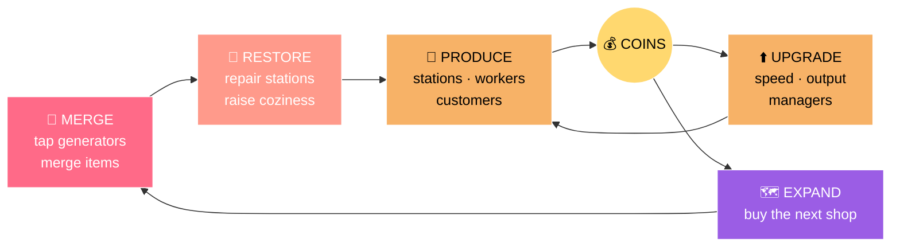
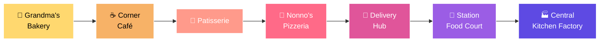
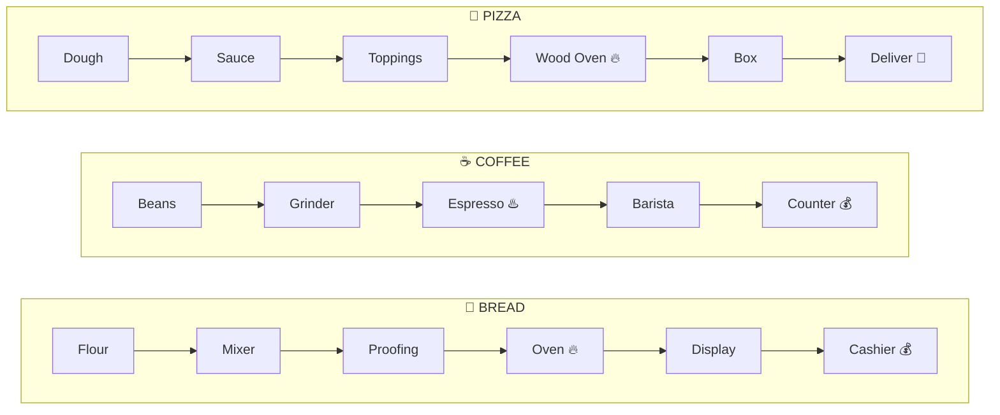
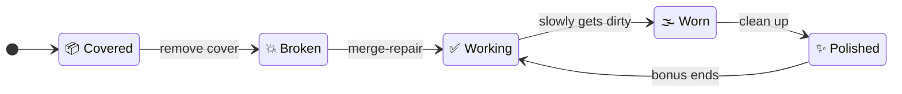
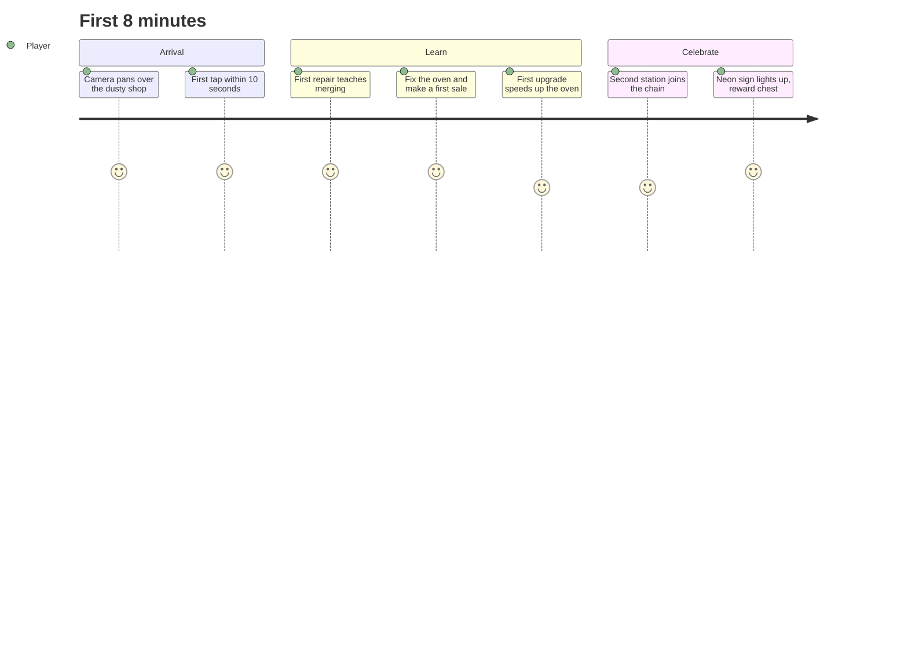
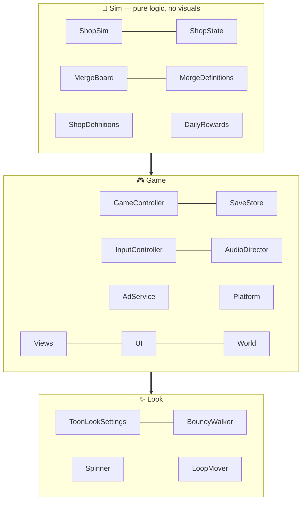

<p align="center">
  
</p>

<p align="center">
  
</p>

<p align="center">
  
  
  
  
  
  
</p>

---

<h2 align="center">🍰 THE PITCH</h2>

<table align="center"><tr><td align="center">
<br/>
<b>Grandma's bakery-café has been closed for 20 years.</b><br/>
You inherit it — dusty, broken and boarded up.<br/><br/>
<b>Merge</b> tools and ingredients to repair it, <b>bake</b> your way to the Grand Opening,<br/>
then <b>expand</b> into a café, patisserie, pizzeria, delivery hub and a full food factory.<br/><br/>
<sub>🐶 With <b>Biscuit</b>, Grandma's fluffy dog and the game's mascot, cheering you on.</sub>
<br/><br/>
</td></tr></table>

---

<p align="center">
  
</p>

---

<h2 align="center">🔁 CORE LOOPS</h2>



| Loop | What you do | Time scale |
|:--|:--|:--|
| 🔀 **Merge** | Tap generators, merge items, deliver them to repair tasks | seconds → minutes |
| 🍞 **Production** | Load supplies, serve, upgrade stations, hire managers to automate | minutes |
| 🔧 **Restore** | Finish areas, unlock stations, raise coziness | minutes → hours |
| 🗺️ **Expand** | Buy the next shop, open new business types on the world map | days |

---

<h2 align="center">🏪 THE SHOP LADDER</h2>



<p align="center"><sub>Old shops keep earning idle income · locked shops tease you as dusty silhouettes · late-game <b>franchise prestige</b> for a permanent multiplier</sub></p>

---

<h2 align="center">⚙️ PRODUCTION CHAINS</h2>



<p align="center"><sub>Every station has a progress ring · 3 upgrades × 5 levels (speed · output · extra machine) · a manager to automate it</sub></p>

---

<p align="center">
  
</p>

---

<h2 align="center">🏚️ ➜ 🏡 THE REPAIR MOMENT</h2>



<p align="center">
<i>Camera glides over → dust puff → sheet flies off → object bounces → colour sweeps back from grey → sparkles & rewards burst out → a worker starts using it.</i>
</p>

---

<p align="center">
  
</p>

---

<h2 align="center">🎓 ONBOARDING — THE GRAND OPENING</h2>



---

<h2 align="center">🛠️ UNDER THE HOOD</h2>



- 🧠 **Simulation is separate from visuals.** Slow devices show less animation but never earn less.
- 📦 **Data-driven:** shops, rooms, chains, recipes, costs, timers and tutorial steps all live in config.
- 💾 **Versioned saves** with offline earnings from timestamps and cloud saves.
- 🌐 **Web-first build:** Brotli, high code stripping, compressed textures and stripped shader variants.
- 📈 **Pacing simulator:** an automated pacing report checks every upgrade gap, renovation and expansion time.
- 📊 **Analytics:** events for every tutorial step and key moment.

---

<h2 align="center">🎯 TARGETS</h2>

<p align="center">
  
  
  
</p>

---

<h2 align="center">🗺️ ROADMAP</h2>

- [x] 🌐 Project setup: web target, platform SDK, build-size settings
- [x] 🎨 The look: isometric camera, toon shader, outlines, polished room
- [x] 🍞 Core idle loop: stations, workers, customers, coins, saves, offline earnings
- [ ] 🏚️ Run-down system: object states, wear shader, repair animation
- [ ] 🔀 Merge board: grid, chains, generators, energy, repair tasks
- [ ] 🎓 Grand Opening tutorial
- [ ] 🗺️ Progression: quests, managers, shops 2–3, world map
- [ ] 🍕 Nonno's Pizzeria and beyond

---

<h2 align="center">🚀 RUN IT</h2>

```bash
git clone https://github.com/vishwaMoger/Merge-Resto.git
```

1. Open the folder in **Unity 6000.3** (Unity 6.3) with **URP**.
2. Open the main scene in `Assets/Scenes`.
3. Press ▶️ **Play**.

📄 Full design: [`GAME_CONCEPT.md`](GAME_CONCEPT.md) · 📈 Pacing: [`Docs/PacingReport.md`](Docs/PacingReport.md)

---

<p align="center">
  <b>Made with ❤️ and lots of 🥐 by <a href="https://github.com/vishwaMoger">Vishwa Moger</a></b><br/>
  <sub>Game Developer · 3+ years · Bangalore, India</sub>
</p>


